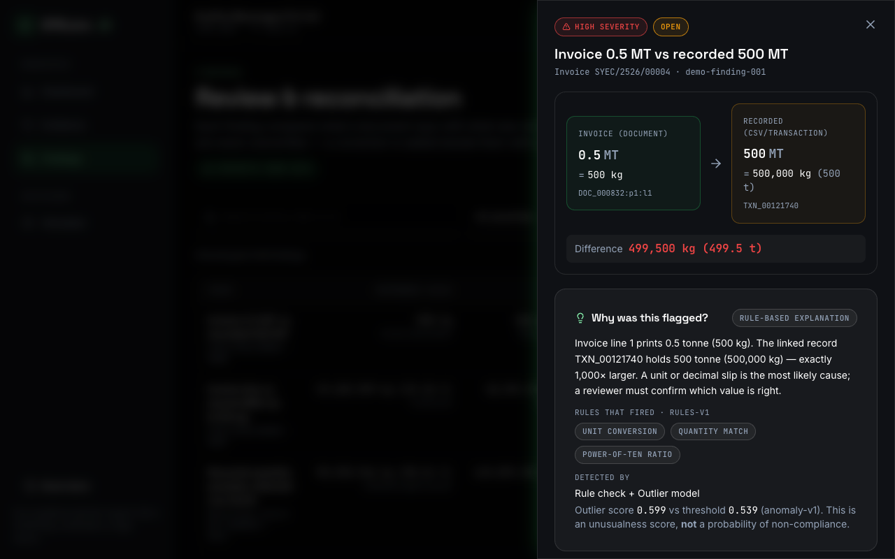
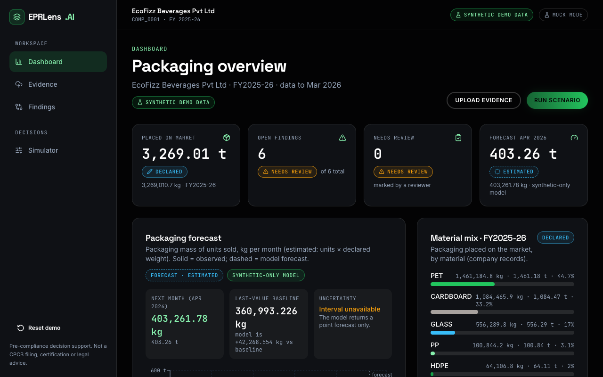
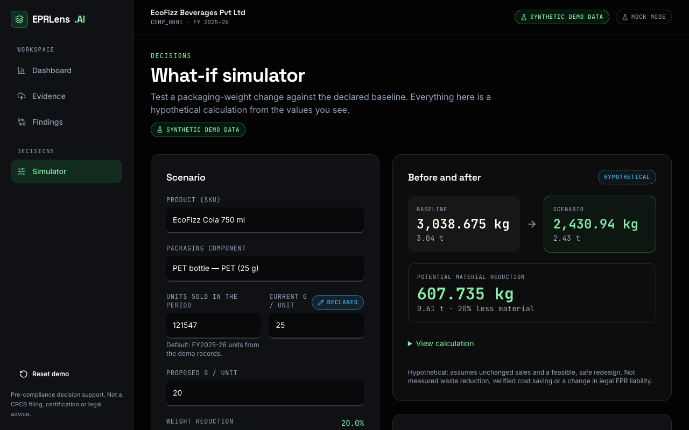
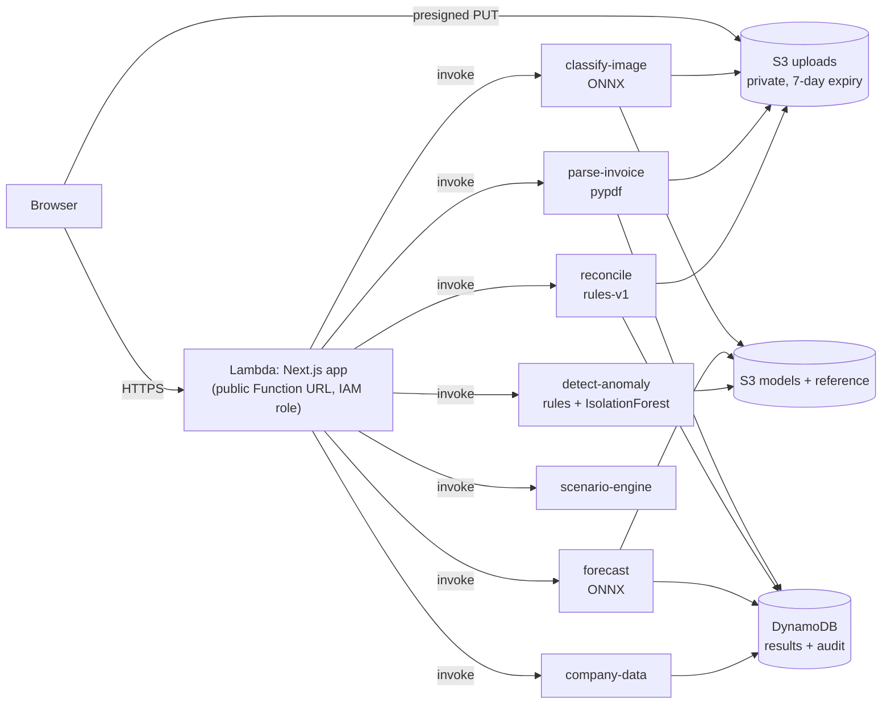

# EPRLens AI — pre-compliance packaging intelligence

> **Hackathon:** Environmental Hacks (WeMakeDevs × AWS) · **Track:** Waste and Energy
> **Live demo (all on AWS):** <https://vnt7lqwiplspftmctdrlriejfa0jclzy.lambda-url.ap-south-1.on.aws/> · **Demo video:** _added at submission_
> **All demo data is synthetic** (fictitious companies). EPRLens is decision support — **not** a CPCB filing, certification or legal advice.

Indian producers, importers and brand owners must report the plastic packaging they put on the market under **Extended Producer Responsibility (EPR)**. Mistakes — a tonne entered as 500 tonnes, a duplicated invoice, a wrong category — are usually found late, when filing. EPRLens lets a company check its own evidence **before** it files.



## What it does
1. **Upload evidence** — a transaction CSV, a digital invoice PDF and a packaging photo (uploaded straight from the browser to private S3).
2. **Read and reconcile** — the invoice is parsed (no OCR), quantities are normalised to kg and compared with the company's records. Example: invoice **0.5 MT = 500 kg** vs record **500 MT = 500,000 kg** → difference **499,500 kg**, flagged with the rule that fired.
3. **Review with an audit trail** — accept or reject a correction with a reason; the original value is never overwritten.
4. **Forecast** next month's packaging mass (XGBoost → ONNX) with the baseline and limits shown; no invented confidence interval.
5. **Detect anomalies** — deterministic rules plus an Isolation Forest, reported separately; a model score is never presented as a probability of non-compliance.
6. **Classify a packaging photo** (MobileNetV3-Small ONNX) into a probable material — never an official EPR category.
7. **What-if simulator** — change grams per unit or units and see the hypothetical kg and tonnes saved (e.g. 100,000 × 25 g → 20 g = 2,500 → 2,000 kg).

| | |
|---|---|
|  |  |

## Built on AWS (S3 · Lambda · DynamoDB only)

Seven Lambda functions, two private S3 buckets and one on-demand DynamoDB table; **no always-on resources**, no API Gateway, EC2, Bedrock or Textract. The web function holds **no access keys** — it uses its own least-privilege IAM role. Details: [`docs/aws-data-flow.md`](docs/aws-data-flow.md), [`infrastructure/README.md`](infrastructure/README.md).

## Try it
**No AWS needed (mock mode, bundled fixtures):**
```bash
cd frontend && npm install && npm run dev        # http://localhost:3000
```
Follow the 3-minute script in [`docs/demo-flow.md`](docs/demo-flow.md) (or open `/app/review?demo=1`).

**Backend locally (no credentials):** see [`docs/local-backend.md`](docs/local-backend.md). **Deploy / tear down on AWS:** [`infrastructure/README.md`](infrastructure/README.md), account setup in [`docs/aws-account-setup.md`](docs/aws-account-setup.md).

## Repository map
| Path | Contents |
|---|---|
| `frontend/` | Next.js 15 app (landing, onboarding, evidence, findings, dashboard, simulator), mock + live adapters, tests |
| `backend/` | The 7 Lambda handlers, shared logic, seed data, tests, parser evaluation |
| `infrastructure/` | AWS CLI scripts: storage, IAM, package, deploy, seed, smoke test, web hosting, teardown |
| `syntheticml/` | Synthetic dataset generator (200 companies, 1,000 invoice PDFs) and the forecast/anomaly models |
| `ml/` | Packaging image classifier (training, ONNX export, evaluation) |
| `docs/` | Data flow, API contracts, local run guide, account setup, demo flow, [`submission.md`](docs/submission.md) |

## Measured results (all on synthetic data — not real-world accuracy)
| Component | Result | Source |
|---|---|---|
| Invoice parser (12 layouts, 1,000 PDFs) | invoice no./date/vendor/total/line count 100%; line quantity 3,839/3,846; kg 3,846/3,846 | `backend/evaluation/invoice_parser_metrics.json` |
| Forecast (XGBoost) | test R² 0.986; MAE 39% lower than last-value baseline | `syntheticml/ml/evaluation/forecast/metrics.json` |
| Anomaly (rules + Isolation Forest) | test F1 0.912, false-positive rate 0.0038 | `syntheticml/docs/ml-model-report.md` |
| Image classifier (MobileNetV3-Small, 7 classes) | accuracy 0.938, macro-F1 0.896 on 2,325 public-dataset test images; expect a drop on real packaging photos | `ml/evaluation/metrics_finetuned.json` |
| Tests | 78 frontend unit/component, 6 end-to-end (desktop + mobile), 37 backend, plus live checks against AWS | `npm test`, `pytest backend`, `infrastructure/scripts/60-smoke.sh`, `65-live-api-check.py` |

## Honest limitations
Synthetic data only; one demo company is pre-seeded and other companies start empty. No login (public demo). Review decisions are stored in the browser, not in the backend. Forecast months after the first are recursive and labelled "projected". The image model sees public waste photos, not retail packaging, so it is an aid with a confirm step. EPR applicability hints come from a secondary handbook and always say "requires verification".

## Team
Frontend and AWS backend/infrastructure: Vaibhav Jain · Synthetic data and tabular models: Debshata Choudhury · Packaging image classifier: Ishani Jindal (per the git history).
